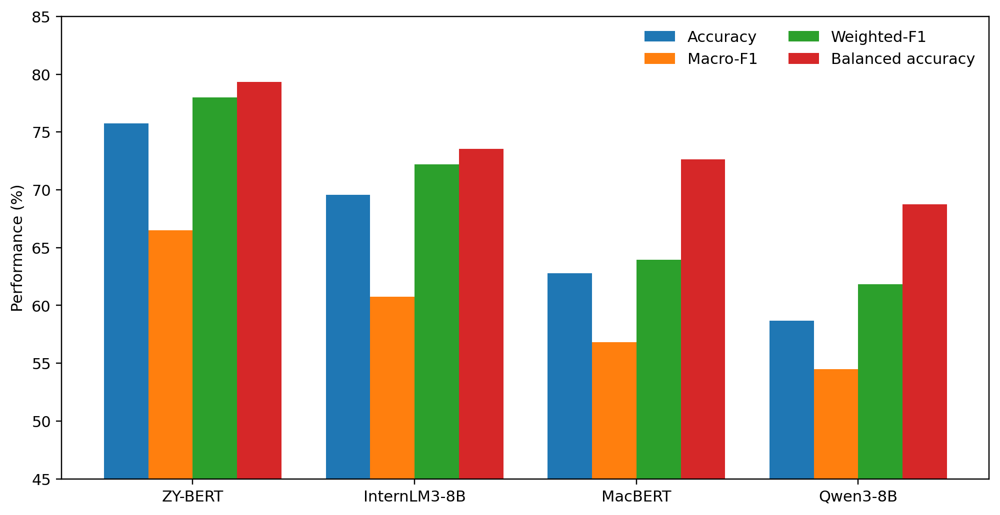
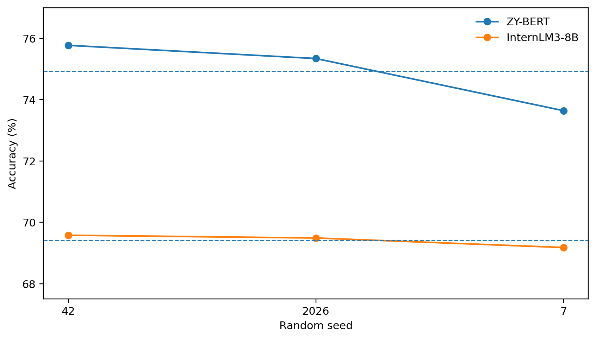

# TCM-SD42: Controlled Model Comparison for TCM Syndrome Differentiation

> **Research archive / Medical NLP / Reproducibility**  
> A controlled, system-level comparison of specialized encoders and general-purpose language models for traditional Chinese medicine syndrome differentiation.

### At a glance

| Study dimension | What is actually evaluated |
| --- | --- |
| Task | Fixed historical **42-class task derived from TCM-SD** |
| Models | ZY-BERT, MacBERT, Qwen3-8B and InternLM3-8B-Instruct |
| Clean held-out split | **4,218 records**, seed 42 |
| Strongest reported baseline in this comparison | **ZY-BERT: 75.77% accuracy / 66.51% macro-F1** |
| Evidence | Evaluation scripts, aggregate results, statistical tests, provenance and known limitations |

**Start with the evidence:** [Results summary](docs/RESULTS_SUMMARY.md) · [Methods](docs/METHODS_SUMMARY.md) · [Statistical tests](docs/STATISTICAL_METHOD.md) · [Dataset provenance](docs/DATASET_PROVENANCE.md) · [Known limitations](docs/KNOWN_LIMITATIONS.md) · [Data availability](docs/DATA_AVAILABILITY.md).

> [!IMPORTANT]
> This is **not** the official normalized 148-class TCM-SD benchmark. The fixed historical task has a disclosed test-informed eligibility rule. The public release intentionally does not include raw clinical records, per-case predictions or trained weights. Interpret the numbers and reproducibility scope in that context.

---

Public reproducibility materials for the study:

**Domain-Specific Encoders versus General-Purpose Large Language Models for Traditional Chinese Medicine Syndrome Differentiation: A Controlled System-Level Evaluation on a TCM-SD-Derived 42-Class Task**

## Read the evidence first

The results below are **historical reported results** on a fixed TCM-SD-derived 42-class task, not a new run or a clinical validation. Start with the [claim-to-evidence map](docs/EVIDENCE_MAP.md), which clearly separates what can be verified from public aggregates from what still requires the original authorized records and checkpoints.



*Existing repository figure, reproduced from published aggregate results; not evidence of a new training run.*

**Reproducibility level:** **Public aggregate consistency check available**; full model training, case-level paired analysis, checkpoint identity, and split reconstruction are **not independently reproducible from this public repository alone**.

Run the read-only check on the published matrices, fixed label vocabulary, per-seed summaries, and the six McNemar/Holm calculations:

```bash
python code/verify_public_aggregates.py
```

This script uses only Python's standard library. A **PASS** means the disclosed aggregate tables agree internally; it does **not** verify case-level predictions, raw clinical records, resampling confidence intervals, checkpoints, or patient independence. See [the evidence map](docs/EVIDENCE_MAP.md) for the complete scope.



*Existing repository figure; three seeds per displayed system. Do not interpret this as a four-model three-seed comparison.*

**Important reporting detail:** Each LLM's published 42×42 confusion matrix contains **4,216 valid-label outputs**, not all **4,218** test cases. The two omitted outputs per model were recorded as non-parsed (`empty`) and count as incorrect against the full denominator. The [evidence map](docs/EVIDENCE_MAP.md#why-the-llm-4242-confusion-matrices-have-4216-entries) shows how to correctly reconstruct Macro-F1 and Balanced Accuracy without silently discarding cases.

**Checkpoint disclosure:** The public InternLM3 *training-time* script saves by Stage-2 dev loss; an author-reported private archive audit describes a separate *official inference* selection by dev Macro-F1 that chose the same epoch-2 adapters for all three seeds. The full separate selection and checkpoint hashes are **not yet available publicly**, so the public archive cannot independently validate that step. See [checkpoint provenance](docs/EVIDENCE_MAP.md#checkpoint-protocol-do-not-conflate-two-stages).

## Scope

This repository documents a **previously established, fixed 42-class syndrome differentiation task derived from clinical records in the public TCM-SD corpus**. TCM-SD42 is **not** the official normalized 148-class TCM-SD benchmark and should not be described as a direct 42-label subset of that normalized taxonomy. TCM-SD contains original `syndrome` annotations and an official normalized `norm_syndrome` label space; the historical TCM-SD42 task uses a fixed set of original syndrome labels with lightweight canonicalization, primarily removal of the trailing Chinese character `证`.

A surviving preprocessing log dated 2026-05-07 records the historical eligibility rule: source syndrome categories were retained when they had at least **100 training records, 10 development records, and 10 test records** in the original TCM-SD splits. Exactly **42** original syndrome categories met all three thresholds. This construction predates the present four-model comparison and did not use model predictions or model performance. Because test-label support contributed to the historical eligibility rule, this is disclosed as a test-informed task-construction limitation.

The comparative experiments reported here keep the resulting TCM-SD42 label space and data partitions fixed across all models.

## Models

- MacBERT (`hfl/chinese-macbert-base`) — discriminative encoder
- ZY-BERT — TCM domain-specific encoder introduced with TCM-SD
- Qwen3-8B — generative LLM, frozen historical QLoRA-SFT protocol
- InternLM3-8B-Instruct — generative LLM, QLoRA-SFT under the locked comparative protocol

## Main clean held-out results (N = 4,218, seed 42)

| Model | Accuracy | Macro-F1 | Weighted-F1 | Balanced Accuracy |
|---|---:|---:|---:|---:|
| ZY-BERT | 75.77% | 66.51% | 78.00% | 79.32% |
| InternLM3-8B | 69.58% | 60.74% | 72.20% | 73.55% |
| MacBERT | 62.78% | 56.81% | 63.94% | 72.63% |
| Qwen3-8B | 58.70% | 54.50% | 61.82% | 68.73% |

Three-seed summaries for ZY-BERT and InternLM3-8B are under `results/three_seed_summary.csv`. Pairwise accuracy comparisons use paired bootstrap confidence intervals, exact McNemar tests, and six-comparison Holm correction.

The v23 statistical addendum additionally reports paired-bootstrap 95% confidence intervals for **Macro-F1** and **Balanced Accuracy** differences. All six Macro-F1 intervals exclude zero. Five of six Balanced Accuracy intervals exclude zero; the InternLM3-versus-MacBERT difference is +0.92 percentage points with 95% CI [-1.46, 3.31]. A class-stratified paired-bootstrap sensitivity analysis preserves the direction of all 12 class-sensitive comparisons and the same qualitative exception. See the ordinary and stratified tables under `results/`, the portable scripts under `code/`, and `docs/STATISTICAL_METHOD.md`.

## Repository contents

```text
code/          parser, evaluator, leakage audit, training/inference reference scripts, pairwise statistics
configs/       model/protocol snapshots
label_space/   fixed 42-label taxonomy
results/       aggregate metrics, seed summaries, confusion matrices, bootstrap summaries, figures
docs/          provenance, methods, statistical methods, results, limitations, availability statements
provenance/    sanitized run-level seals and artifact provenance summaries
data/          schema only; no clinical records
paper/         manuscript-publication note; full draft intentionally not included
```

## Why raw records and predictions are not here

This release intentionally excludes raw clinical records, per-case predictions, trained model weights, private compute paths, and operational logs. The source TCM-SD dataset can be obtained from its official release. See `DATA_LICENSE_NOTICE.md` and `docs/DATA_AVAILABILITY.md`.

## Quick checks

```bash
pip install -r requirements.txt
python code/parser_tests.py
```

To recompute metrics from standardized prediction files (`id`, `gold`, `pred`), use `code/evaluate.py`. For the published pairwise summaries, see the files under `results/` and the methodology under `docs/STATISTICAL_METHOD.md`.

## Recovered provenance evidence

The historical four-layer leakage-audit implementation was recovered and is published as `code/audit_leakage.py`. The v23 class-sensitive statistics addendum was also recovered; its ordinary and class-stratified aggregate tables and portable verification scripts are included here. The run-level seal coverage and the remaining evidence gap are summarized in `docs/PROVENANCE_EVIDENCE.md` and `provenance/seal_summary.json`.

The original `preprocess_tcm_sd_v4_topn.py` source was not found in the archived search. It is not reconstructed or mislabeled as original source. The support-threshold rule remains documented from surviving logs and is disclosed as a historical task-construction limitation.

## Provenance notes

The exact 42-label task predates the current comparative experiments and was held fixed throughout them. See `docs/DATASET_PROVENANCE.md`, `docs/PROVENANCE_EVIDENCE.md`, and `docs/KNOWN_LIMITATIONS.md` for the full audit trail and limitations.

## Citation

Please cite the original TCM-SD paper when using the source dataset or ZY-BERT. A citation entry for the present study should be added after the final author list and publication/preprint identifier are available.

## License

Original code in this repository is released under the MIT License. TCM-SD data are not included and remain subject to the source dataset license; see `DATA_LICENSE_NOTICE.md`.
